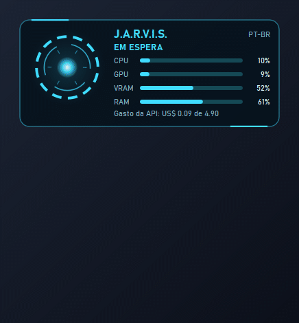
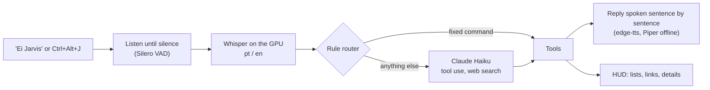

# J.A.R.V.I.S.

[](https://github.com/VitorCamprubi/jarvis/actions/workflows/ci.yml)


[](LICENSE)

**English** · [Português](README.pt-BR.md)

A personal voice assistant for Windows that speaks Brazilian Portuguese and English, inspired
by J.A.R.V.I.S. from the Iron Man films. Say "Ei Jarvis" or press a key, ask, and it acts on
the PC, looks things up on the web and answers out loud in the manner of a formal British
butler, while a heads-up display shows what is going on.



<sub>The HUD's own code rendering a scripted session (`scripts/render_hud_demo.py`).</sub>

## What it does

| Say (pt / en) | JARVIS |
|---|---|
| "Ei Jarvis, abre o Spotify" / "Hey Jarvis, open Spotify" | Opens any app in the Start menu (approximate names, aliases) |
| "Abre o YouTube" / "Go to github dot com" | Opens favourite sites or a spoken domain |
| "Como está o PC?" / "System status" | CPU, RAM, GPU load and temperature, details on the HUD |
| "Pausa a música", "Próxima" / "Pause", "Next song" | Media keys (works with Spotify Free) |
| "Volume em 30%", "Mudo" / "Volume up", "Mute" | Master volume |
| "Bloqueia o computador" / "Lock the computer" | Locks the PC |
| "Desliga o computador", "Fecha o Discord" / "Restart my PC" | Asks "Shall I proceed, sir?" and acts only on a spoken yes |
| "Me lembra em 20 minutos de tirar a pizza" / "Remind me to call John at 6 pm" | Reminders that survive restarts; list and cancel them by voice |
| "Vai chover amanhã?" / "What's the weather like in London?" | Weather now, today or tomorrow |
| "Procura o arquivo currículo", "Abre o segundo" | Finds files in Desktop, Documents and Downloads; programs are only shown, never run |
| "Quais as notícias de hoje?" / "What's the latest tech news?" | The main tech stories of the last 24 hours, from RSS feeds and Google News |
| "Bom dia, Jarvis" / "Good morning, Jarvis" | Morning briefing: weather, today's reminders and three stories |
| "Pesquisa quem ganhou o jogo do Flamengo" / "Search the web for…" | Searches the web and answers only from what it found, with the sources on the HUD |
| "Fala em inglês" / "Speak Portuguese" | Locks the reply language, or goes back to answering in the language spoken |
| Anything else: "Quem descobriu o Brasil?", "E amanhã?" | Claude answers briefly, remembering the last few exchanges |

While it speaks, the hotkey or "Ei Jarvis" cuts it short and it listens again.

## How it works



Simple commands never reach the LLM: bilingual regular-expression rules answer them locally,
for free, in about a second. Everything else goes to Claude Haiku with the same tools, which
form an explicit allowlist. The core runs on its own asyncio thread and Qt owns the main
thread for the HUD, so the interface never freezes. Details in
[docs/ARCHITECTURE.md](docs/ARCHITECTURE.md).

## Stack

| Concern | Choice |
|---|---|
| Language and tooling | Python 3.14, uv, ruff, mypy (strict), pytest, GitHub Actions |
| Wake word | openWakeWord ("hey jarvis"), confirmed by Whisper for Brazilian accents |
| Speech to text | faster-whisper large-v3-turbo on CUDA (int8_float16), Silero VAD v6 |
| Text to speech | edge-tts neural voices, Piper as the offline fallback, a phrase cache |
| Brain | Claude Haiku 5.5 through the Anthropic SDK: tool use, prompt caching, web search |
| Interface | PySide6 (Qt): a translucent HUD painted with QPainter, a tray icon |
| Data | SQLite (reminders, API spending, settings), Open-Meteo, RSS with feedparser |
| Windows | Win32 through ctypes (hotkey, windows, session), Core Audio (pycaw), NVML |

## Requirements

- Windows 10 or 11 with an NVIDIA GPU (speech recognition runs on CUDA; without it, it falls
  back to the CPU, slowly)
- A microphone, ideally a headset
- [uv](https://docs.astral.sh/uv/), which installs Python 3.14 by itself
- Optional: an Anthropic API key, for free questions, web search and news summaries

The first installation downloads about 1.5 GB (CUDA libraries included); the first start
downloads the speech model (about 1.5 GB), the offline voices (about 120 MB) and the wake
word model (a few MB).

## Installation

```powershell
winget install --id=astral-sh.uv -e
git clone https://github.com/VitorCamprubi/jarvis.git C:\dev\jarvis
cd C:\dev\jarvis
uv sync
uv run jarvis --check
```

Clone into a short folder (up to about 80 characters): some installed files have long names,
and Windows limits paths to 260 characters unless long paths are enabled. `--check`
verifies Python, the GPU and CUDA, the configuration, the hotkey, the microphone and
speakers, the wake word model, the API key and the spending so far.

### Claude API key (optional)

Without a key, every command above works except free questions and web search; news are
then read as plain headlines.

1. In the [Claude Console](https://platform.claude.com/), buy a small amount of credit, leave
   auto-reload off and set a spend limit.
2. Create a personal API key scoped to one workspace.
3. Copy `.env.example` to `.env` and paste the key after `ANTHROPIC_API_KEY=`. `.env` is
   git-ignored: never paste the key anywhere else.
4. Run `uv run jarvis --check`: it validates the key without spending tokens.

JARVIS records the estimated cost of every request in `data/jarvis.db`, warns at US$ 4.00
and stops calling the API at US$ 4.90. A question costs about US$ 0.0002 and a web search
about US$ 0.012, so searches are limited to 20 a day.

## Usage

```powershell
uv run jarvis
```

Say **"Ei Jarvis"** (or "Hey Jarvis"), or press **Ctrl+Alt+J**, and ask; the request can
follow in the same breath. The single word "Jarvis" is not enough: the wake word model needs
the greeting. Press the hotkey again while it is listening to cancel.

The HUD floats in the top right corner (drag it anywhere; it remembers the place) and never
takes the keyboard focus. It steps aside while a game or a video is in full screen. The tray
icon shows or hides it and quits JARVIS, as does Ctrl+C in the console.

| Command | What it does |
|---|---|
| `uv run jarvis` | Starts JARVIS |
| `uv run jarvis --check` | Checks the environment, the API key and the spending |
| `uv run jarvis --devices` | Lists microphones and audio outputs |
| `uv run jarvis --mic-test` | Measures background noise and your voice, suggests the VAD level |
| `uv run jarvis --autostart on\|off\|status` | Starts JARVIS with Windows, without a console window |

Settings live in [`config/default.toml`](config/default.toml); put your own changes in
`config/local.toml` (see [`config/local.example.toml`](config/local.example.toml)): weather
city, news sources, favourite sites, app aliases, voices, wake word sensitivity, HUD, budget.

## Privacy and safety

- The LLM can only call the registered tools. There is no shell or code-execution tool, and
  no tool deletes files. Programs and scripts found by the file search are shown in Explorer,
  never run.
- Shutting down, restarting and closing programs always wait for a spoken "yes".
- Web pages, news and search results are data, never instructions. Answers about news and
  searches come only from what was fetched; "I could not find it" is an acceptable answer.
- Audio never leaves the PC: speech is recognised locally. Only text goes out: the request
  to Claude, the reply to the speech service, the city to Open-Meteo.
- With the wake word on, the microphone stays open and Windows shows its indicator; turn it
  off with `[wake] enabled = false`. Transcripts stay in `logs/` and can be switched off.
- Keys live only in `.env`, outside Git.

## Performance

Measured on a Ryzen 5 5600G with an RTX 4060 Ti 8 GB:

| Step | Time |
|---|---|
| Speech recognition (short request) | 0.36 s, using 1.1 GB of video memory |
| Wake word | about 2% of one CPU core; "Hey Jarvis" wakes at once, a Brazilian "Ei Jarvis" in about 1.2 s |
| Local command, end of speech to first word | about 1.0 s (phrase already cached) to 1.8 s |
| Question to Claude | about 2.5–3.5 s |
| Long reply (news) | first sentence after 1.6 s instead of 4.2 s, by speaking sentence by sentence |
| Web search | about 5–6 s (the search alone takes 4–5 s) |
| HUD | 0% CPU at rest, about 3% while speaking |

## Technical decisions

All 49 decisions are recorded as short ADRs in [docs/DECISIONS.md](docs/DECISIONS.md). A few
of the more interesting ones:

- [ADR-004](docs/DECISIONS.md#adr-004-concurrency-asyncio-core-worker-threads-qt-on-the-main-thread):
  an asyncio core on its own thread, blocking work on worker threads, Qt on the main thread.
- [ADR-010](docs/DECISIONS.md#adr-010-us-5-spending-cap-enforced-in-two-layers): a US$ 5
  cap, enforced by the Console and by a local guard that prices every response.
- [ADR-019](docs/DECISIONS.md#adr-019-rule-router-with-regular-expressions-per-language) and
  [ADR-020](docs/DECISIONS.md#adr-020-explicit-tool-list-as-the-allowlist): rules first, and
  an explicit tool list as the LLM's allowlist.
- [ADR-026](docs/DECISIONS.md#adr-026-claude-through-the-official-sdk-with-our-own-tool-use-loop):
  our own tool-use loop, where action tools speak for themselves and save a second LLM call.
- [ADR-034](docs/DECISIONS.md#adr-034-web-search-through-claudes-own-search-tool): web
  search through Claude's search tool, after free DuckDuckGo scraping proved unreliable.
- [ADR-040](docs/DECISIONS.md#adr-040-wake-word-ei-jarvis--hey-jarvis-with-openwakeword-confirmed-by-whisper):
  a pre-trained wake word that misses Brazilian accents, rescued by a Whisper check.
- [ADR-042](docs/DECISIONS.md#adr-042-speaking-sentence-by-sentence): speaking sentence by
  sentence to cut the wait before long replies.

## Project layout

```
src/jarvis/
  activation/   global hotkey
  audio/        shared microphone, wake word, VAD, tones, playback
  brain/        Claude provider, tool-use loop, persona, memory, budget, news bulletin
  config/       TOML settings validated by pydantic, secrets from .env
  core/         event loop thread, conversation pipeline, events for the HUD
  hud/          PySide6 window, reactor, gauges, tray icon
  i18n/         pt-BR and en texts
  router/       bilingual rule router
  storage/      SQLite
  stt/, tts/    speech recognition and synthesis
  text/         normalisation, numbers, times, sentences
  tools/        one module per tool; the list in __init__.py is the allowlist
  windows/      Win32: Start menu, windows, volume, metrics, autostart
tests/          557 tests; no network, microphone or GPU needed
```

## Development

```powershell
uv run ruff format
uv run ruff check
uv run mypy
uv run pytest
```

CI runs the same four steps on Windows for every push; the Qt tests run offscreen.

## Known limitations and next steps

- The wake word needs "Ei/Hey Jarvis"; a single-word model trained with Brazilian voices is
  a v2 idea.
- Playing a specific song or playlist needs the Spotify Web API (and Premium); v1 drives the
  media keys only.
- edge-tts relies on an unofficial Microsoft endpoint; when it changes, JARVIS falls back to
  the offline voice until edge-tts is updated.
- Windows only.

More ideas in [docs/V2_IDEAS.md](docs/V2_IDEAS.md); each requirement of the original brief,
and how it was met, in [docs/REQUIREMENTS.md](docs/REQUIREMENTS.md).

## Licenses and credits

JARVIS is released under the [MIT license](LICENSE). It uses, without redistributing them:

- [openWakeWord](https://github.com/dscripka/openWakeWord) (Apache 2.0); its pre-trained
  "hey jarvis" model is CC BY-NC-SA 4.0, so for non-commercial use only.
- [Piper](https://github.com/rhasspy/piper) (GPL-3.0) with the voices pt_BR-faber (CC0) and
  en_GB-alan (CC BY-SA).
- [faster-whisper](https://github.com/SYSTRAN/faster-whisper) and OpenAI's Whisper models
  (MIT), [Silero VAD](https://github.com/snakers4/silero-vad) (MIT).
- [edge-tts](https://github.com/rany2/edge-tts) (LGPL-3.0),
  [PySide6](https://doc.qt.io/qtforpython-6/) (LGPL-3.0), weather data by
  [Open-Meteo](https://open-meteo.com/) (CC BY 4.0).

J.A.R.V.I.S. and Iron Man belong to Marvel. This is a fan-made personal project: its lines
are original and its voices are not cloned from anyone.
