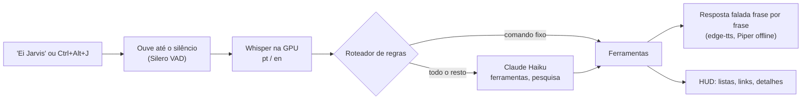

# J.A.R.V.I.S.

[](https://github.com/VitorCamprubi/jarvis/actions/workflows/ci.yml)


[](LICENSE)

[English](README.md) · **Português**

Um assistente de voz pessoal para Windows, em português do Brasil e em inglês, inspirado no
J.A.R.V.I.S. dos filmes do Homem de Ferro. Diga "Ei Jarvis" ou aperte um atalho, peça, e ele
age no PC, pesquisa na web e responde falando, como um mordomo britânico formal, enquanto um
HUD mostra o que está acontecendo.


<sub>O próprio código do HUD desenhando uma sessão roteirizada (`scripts/render_hud_demo.py`).</sub>

## O que ele faz

| Diga (pt / en) | JARVIS |
|---|---|
| "Ei Jarvis, abre o Spotify" / "Hey Jarvis, open Spotify" | Abre qualquer app do Menu Iniciar (nomes aproximados, apelidos) |
| "Abre o YouTube" / "Go to github dot com" | Abre sites favoritos ou um domínio falado |
| "Como está o PC?" / "System status" | Uso e temperatura de CPU, RAM e GPU, com detalhes no HUD |
| "Pausa a música", "Próxima" / "Pause", "Next song" | Teclas de mídia (funciona com o Spotify gratuito) |
| "Volume em 30%", "Mudo" / "Volume up", "Mute" | Volume geral |
| "Bloqueia o computador" / "Lock the computer" | Bloqueia o PC |
| "Desliga o computador", "Fecha o Discord" / "Restart my PC" | Pergunta "Shall I proceed, sir?" e só age com um "sim" falado |
| "Me lembra em 20 minutos de tirar a pizza" / "Remind me to call John at 6 pm" | Lembretes que sobrevivem a reinícios; listar e cancelar por voz |
| "Vai chover amanhã?" / "What's the weather like in London?" | Clima agora, hoje ou amanhã |
| "Procura o arquivo currículo", "Abre o segundo" | Acha arquivos na Área de Trabalho, Documentos e Downloads; programas só são mostrados, nunca executados |
| "Quais as notícias de hoje?" / "What's the latest tech news?" | As principais notícias de tecnologia das últimas 24 horas, de feeds RSS e do Google Notícias |
| "Bom dia, Jarvis" / "Good morning, Jarvis" | Resumo do dia: clima, lembretes de hoje e três notícias |
| "Pesquisa quem ganhou o jogo do Flamengo" / "Search the web for…" | Pesquisa na web e responde só com o que achou, com as fontes no HUD |
| "Fala em inglês" / "Speak Portuguese" | Trava o idioma da resposta, ou volta a responder no idioma falado |
| Qualquer outra coisa: "Quem descobriu o Brasil?", "E amanhã?" | O Claude responde curto, lembrando das últimas trocas |

Enquanto ele fala, o atalho ou "Ei Jarvis" interrompe e ele volta a ouvir.

## Como funciona



Comandos simples nunca chegam ao LLM: regras bilíngues com expressões regulares respondem
localmente, de graça, em cerca de um segundo. O resto vai para o Claude Haiku com as mesmas
ferramentas, que formam uma lista permitida explícita. O núcleo roda na sua própria thread
asyncio e o Qt fica com a thread principal para o HUD, então a interface nunca trava.
Detalhes em [docs/ARCHITECTURE.md](docs/ARCHITECTURE.md) (em inglês).

## Tecnologias

| Parte | Escolha |
|---|---|
| Linguagem e ferramentas | Python 3.14, uv, ruff, mypy (strict), pytest, GitHub Actions |
| Palavra de ativação | openWakeWord ("hey jarvis"), confirmada pelo Whisper para o sotaque brasileiro |
| Fala para texto | faster-whisper large-v3-turbo em CUDA (int8_float16), Silero VAD v6 |
| Texto para fala | Vozes neurais do edge-tts, Piper como reserva offline, cache de frases |
| Cérebro | Claude Haiku 5.5 pelo SDK da Anthropic: ferramentas, cache de prompt, pesquisa na web |
| Interface | PySide6 (Qt): HUD translúcido desenhado com QPainter, ícone na bandeja |
| Dados | SQLite (lembretes, gasto da API, configurações), Open-Meteo, RSS com feedparser |
| Windows | Win32 via ctypes (atalho, janelas, sessão), Core Audio (pycaw), NVML |

## Requisitos

- Windows 10 ou 11 com placa de vídeo NVIDIA (o reconhecimento de fala usa CUDA; sem ela,
  usa a CPU, devagar)
- Microfone, de preferência um headset
- [uv](https://docs.astral.sh/uv/), que instala o Python 3.14 sozinho
- Opcional: uma chave da API da Anthropic, para perguntas livres, pesquisa e resumo de notícias

A primeira instalação baixa cerca de 1,5 GB (com as bibliotecas CUDA); a primeira execução
baixa o modelo de fala (cerca de 1,5 GB), as vozes offline (cerca de 120 MB) e o modelo da
palavra de ativação (poucos MB).

## Instalação

```powershell
winget install --id=astral-sh.uv -e
git clone https://github.com/VitorCamprubi/jarvis.git C:\dev\jarvis
cd C:\dev\jarvis
uv sync
uv run jarvis --check
```

Clone numa pasta de caminho curto (até uns 80 caracteres): alguns arquivos instalados têm
nomes longos, e o Windows limita caminhos a 260 caracteres, a menos que os caminhos longos
estejam ativados. O `--check` verifica Python, GPU e CUDA, a configuração, o atalho, o
microfone e os alto-falantes, o modelo da palavra de ativação, a chave da API e o gasto.

### Chave da API do Claude (opcional)

Sem a chave, todos os comandos acima funcionam, menos as perguntas livres e a pesquisa na
web; as notícias são lidas como manchetes.

1. No [Claude Console](https://platform.claude.com/), compre um pouco de crédito, deixe a
   recarga automática desligada e defina um limite de gasto.
2. Crie uma chave pessoal, restrita a um workspace.
3. Copie o `.env.example` para `.env` e cole a chave depois de `ANTHROPIC_API_KEY=`. O
   `.env` fica fora do Git: nunca cole a chave em outro lugar.
4. Rode `uv run jarvis --check`: ele valida a chave sem gastar tokens.

O JARVIS registra o custo estimado de cada pedido em `data/jarvis.db`, avisa em US$ 4,00 e
para de chamar a API em US$ 4,90. Uma pergunta custa cerca de US$ 0,0002 e uma pesquisa na
web cerca de US$ 0,012, por isso as pesquisas são limitadas a 20 por dia.

## Uso

```powershell
uv run jarvis
```

Diga **"Ei Jarvis"** (ou "Hey Jarvis"), ou aperte **Ctrl+Alt+J**, e peça; o pedido pode vir
na mesma frase. Só "Jarvis" não basta: o modelo precisa do cumprimento. Aperte o atalho de
novo enquanto ele ouve para cancelar.

O HUD flutua no canto superior direito (arraste para onde quiser; ele lembra o lugar) e nunca
rouba o foco do teclado. Ele sai da frente quando um jogo ou vídeo está em tela cheia. O
ícone na bandeja mostra ou esconde o HUD e encerra o JARVIS, assim como o Ctrl+C no console.

| Comando | O que faz |
|---|---|
| `uv run jarvis` | Inicia o JARVIS |
| `uv run jarvis --check` | Verifica o ambiente, a chave da API e o gasto |
| `uv run jarvis --devices` | Lista microfones e saídas de áudio |
| `uv run jarvis --mic-test` | Mede o ruído de fundo e a sua voz, e sugere o nível do VAD |
| `uv run jarvis --autostart on\|off\|status` | Inicia o JARVIS com o Windows, sem janela de console |

As configurações ficam em [`config/default.toml`](config/default.toml); coloque as suas em
`config/local.toml` (veja [`config/local.example.toml`](config/local.example.toml)): cidade
do clima, fontes de notícias, sites favoritos, apelidos de apps, vozes, sensibilidade da
palavra de ativação, HUD, orçamento.

## Privacidade e segurança

- O LLM só pode chamar as ferramentas registradas. Não há ferramenta de shell nem de
  execução de código, e nenhuma ferramenta apaga arquivos. Programas e scripts achados na
  busca de arquivos são mostrados no Explorer, nunca executados.
- Desligar, reiniciar e fechar programas sempre esperam um "sim" falado.
- Páginas da web, notícias e resultados de pesquisa são dados, nunca instruções. Respostas
  sobre notícias e pesquisas vêm só do que foi buscado; "não encontrei" é uma resposta válida.
- O áudio nunca sai do PC: a fala é reconhecida localmente. Só sai texto: o pedido ao
  Claude, a resposta ao serviço de voz, a cidade ao Open-Meteo.
- Com a palavra de ativação ligada, o microfone fica aberto e o Windows mostra o indicador;
  desligue com `[wake] enabled = false`. As transcrições ficam em `logs/` e podem ser
  desligadas.
- Chaves ficam só no `.env`, fora do Git.

## Desempenho

Medido num Ryzen 5 5600G com RTX 4060 Ti 8 GB:

| Etapa | Tempo |
|---|---|
| Reconhecimento de fala (pedido curto) | 0,36 s, usando 1,1 GB de memória de vídeo |
| Palavra de ativação | cerca de 2% de um núcleo; "Hey Jarvis" acorda na hora, um "Ei Jarvis" brasileiro em cerca de 1,2 s |
| Comando local, do fim da fala à primeira palavra | cerca de 1,0 s (frase já em cache) a 1,8 s |
| Pergunta ao Claude | cerca de 2,5–3,5 s |
| Resposta longa (notícias) | primeira frase em 1,6 s em vez de 4,2 s, falando frase por frase |
| Pesquisa na web | cerca de 5–6 s (só a pesquisa leva 4–5 s) |
| HUD | 0% de CPU em espera, cerca de 3% falando |

## Decisões técnicas

As 49 decisões estão registradas como ADRs curtos em [docs/DECISIONS.md](docs/DECISIONS.md)
(em inglês). Algumas das mais interessantes:

- [ADR-004](docs/DECISIONS.md#adr-004-concurrency-asyncio-core-worker-threads-qt-on-the-main-thread):
  núcleo asyncio na sua própria thread, trabalho bloqueante em threads de apoio, Qt na
  thread principal.
- [ADR-010](docs/DECISIONS.md#adr-010-us-5-spending-cap-enforced-in-two-layers): teto de
  US$ 5, garantido pelo Console e por um controle local que precifica cada resposta.
- [ADR-019](docs/DECISIONS.md#adr-019-rule-router-with-regular-expressions-per-language) e
  [ADR-020](docs/DECISIONS.md#adr-020-explicit-tool-list-as-the-allowlist): regras primeiro, e
  uma lista explícita de ferramentas como lista permitida do LLM.
- [ADR-026](docs/DECISIONS.md#adr-026-claude-through-the-official-sdk-with-our-own-tool-use-loop):
  laço de ferramentas próprio, em que ferramentas de ação falam por si e economizam uma
  segunda chamada ao LLM.
- [ADR-034](docs/DECISIONS.md#adr-034-web-search-through-claudes-own-search-tool): pesquisa
  pela ferramenta de busca do Claude, depois que raspar o DuckDuckGo de graça se mostrou
  instável.
- [ADR-040](docs/DECISIONS.md#adr-040-wake-word-ei-jarvis--hey-jarvis-with-openwakeword-confirmed-by-whisper):
  um modelo pronto de palavra de ativação que falha com sotaque brasileiro, salvo por uma
  confirmação do Whisper.
- [ADR-042](docs/DECISIONS.md#adr-042-speaking-sentence-by-sentence): falar frase por frase
  para encurtar a espera das respostas longas.

## Estrutura do projeto

```
src/jarvis/
  activation/   atalho global
  audio/        microfone compartilhado, palavra de ativação, VAD, bipes, reprodução
  brain/        Claude, laço de ferramentas, persona, memória, orçamento, boletim de notícias
  config/       configuração TOML validada pelo pydantic, segredos do .env
  core/         thread do núcleo, pipeline da conversa, eventos para o HUD
  hud/          janela PySide6, reator, medidores, ícone na bandeja
  i18n/         textos em pt-BR e en
  router/       roteador de regras bilíngue
  storage/      SQLite
  stt/, tts/    reconhecimento e síntese de fala
  text/         normalização, números, horários, frases
  tools/        um módulo por ferramenta; a lista em __init__.py é a lista permitida
  windows/      Win32: Menu Iniciar, janelas, volume, métricas, inicialização
tests/          557 testes; não precisam de rede, microfone nem GPU
```

## Desenvolvimento

```powershell
uv run ruff format
uv run ruff check
uv run mypy
uv run pytest
```

O CI roda os mesmos quatro passos no Windows a cada push; os testes do Qt rodam sem tela.

## Limitações conhecidas e próximos passos

- A palavra de ativação precisa de "Ei/Hey Jarvis"; um modelo de uma palavra só, treinado
  com vozes brasileiras, é uma ideia para a v2.
- Tocar uma música ou playlist específica precisa da API do Spotify (e de Premium); a v1
  usa só as teclas de mídia.
- O edge-tts depende de um serviço não oficial da Microsoft; quando ele muda, o JARVIS usa a
  voz offline até o edge-tts ser atualizado.
- Só Windows.

Mais ideias em [docs/V2_IDEAS.md](docs/V2_IDEAS.md); cada requisito do briefing original, e
como foi atendido, em [docs/REQUIREMENTS.md](docs/REQUIREMENTS.md).

## Licenças e créditos

O JARVIS é distribuído sob a [licença MIT](LICENSE). Ele usa, sem redistribuir:

- [openWakeWord](https://github.com/dscripka/openWakeWord) (Apache 2.0); o modelo pronto
  "hey jarvis" é CC BY-NC-SA 4.0, portanto só para uso não comercial.
- [Piper](https://github.com/rhasspy/piper) (GPL-3.0) com as vozes pt_BR-faber (CC0) e
  en_GB-alan (CC BY-SA).
- [faster-whisper](https://github.com/SYSTRAN/faster-whisper) e os modelos Whisper da OpenAI
  (MIT), [Silero VAD](https://github.com/snakers4/silero-vad) (MIT).
- [edge-tts](https://github.com/rany2/edge-tts) (LGPL-3.0),
  [PySide6](https://doc.qt.io/qtforpython-6/) (LGPL-3.0), dados de clima do
  [Open-Meteo](https://open-meteo.com/) (CC BY 4.0).

J.A.R.V.I.S. e Homem de Ferro pertencem à Marvel. Este é um projeto pessoal de fã: as falas
são originais e as vozes não são clonadas de ninguém.
