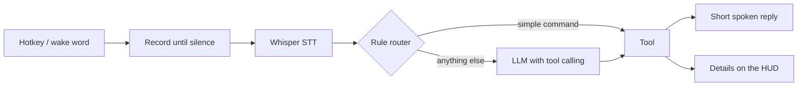
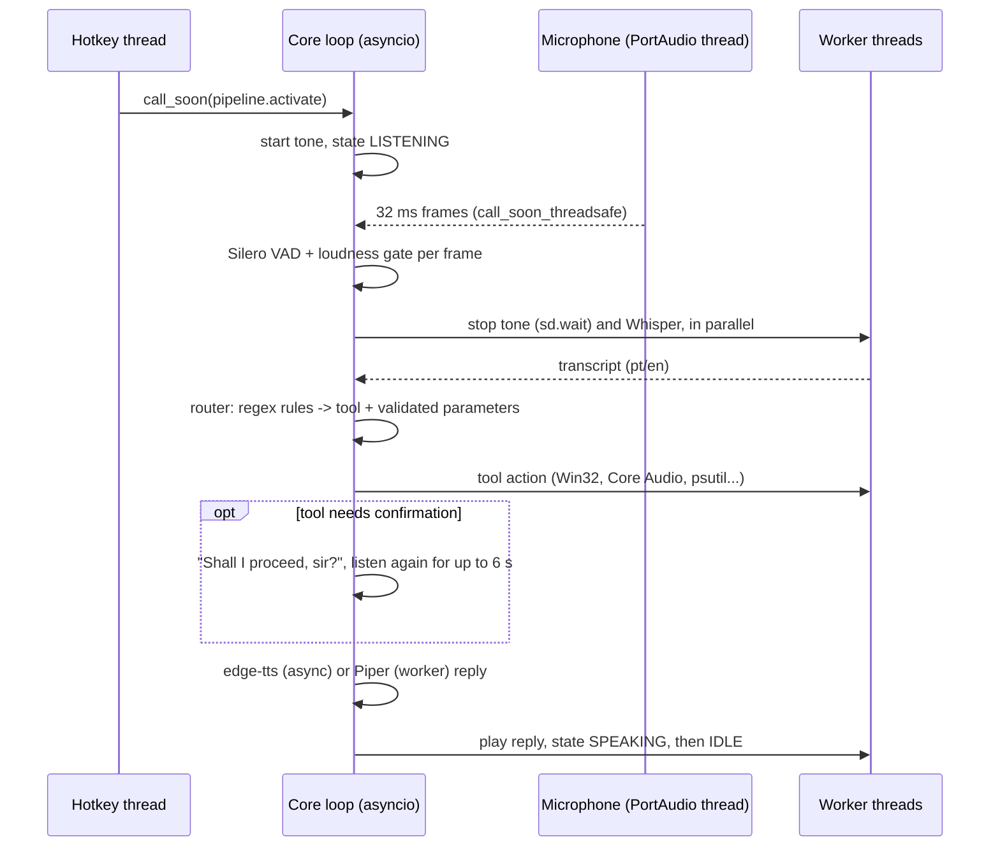
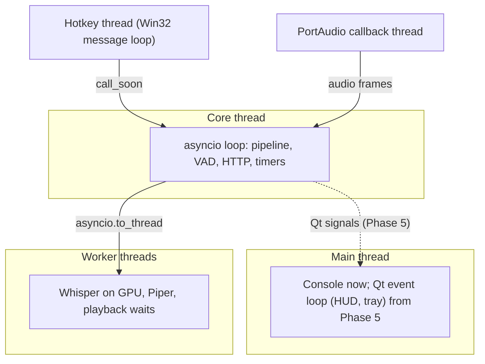

# Architecture

Target architecture of JARVIS v1, built phase by phase. Packages that are still empty
only carry a docstring describing their future responsibility.

## Components

| Package | Responsibility | Since |
|---|---|---|
| `jarvis.app` | Composition root: builds the components and wires them together | Phase 0 |
| `jarvis.config` | Layered TOML configuration and secrets | Phase 0 |
| `jarvis.core` | Core event loop thread, conversation pipeline, states, speaker-verification hook | Phase 1 |
| `jarvis.activation` | Global hotkey (Win32 `RegisterHotKey`); wake word in Phase 6 | Phase 1 |
| `jarvis.audio` | Microphone capture, Silero VAD + loudness gate, feedback tones, playback | Phase 1 |
| `jarvis.stt` | faster-whisper on CUDA, language restricted to pt/en | Phase 1 |
| `jarvis.tts` | edge-tts with phrase cache, Piper as offline fallback | Phase 1 |
| `jarvis.i18n` | pt-BR and en texts loaded from locale files | Phase 1 |
| `jarvis.text` | Normalisation, spoken numbers, yes/no answers, fuzzy name matching | Phase 2 |
| `jarvis.router` | Bilingual rule router (regex per language); unresolved requests go to the LLM | Phase 2 |
| `jarvis.tools` | Explicit tool list (the allowlist) and one module per tool | Phase 2 |
| `jarvis.windows` | Windows integration: Start menu, media keys, Core Audio, metrics, windows, session | Phase 2 |
| `jarvis.brain` | Claude provider, persona, short conversation memory | Phase 3 |
| `jarvis.storage` | SQLite persistence (reminders, API spending) | Phase 3 |
| `jarvis.hud` | PySide6 heads-up display and tray icon | Phase 5 |

Each pluggable component is a `typing.Protocol` (`Listener`, `SpeechToText`,
`TextToSpeech`, `Player`, `SpeakerVerifier`, `Volume`), so tests replace them with simple
fakes and later phases can swap implementations without touching the pipeline.

## Tools

Every tool subclasses `Tool[P]`, where `P` is a pydantic model of its parameters:

| Member | Purpose |
|---|---|
| `name`, `description` | Identify the tool; the description is written for the LLM (Phase 3) |
| `params_model` | Validates arguments from the router or the LLM; its JSON schema feeds tool calling |
| `intents` | Regular expressions per language (`phrasings(pt=..., en=...)`), with named groups |
| `accepts()` | Optional extra check after a regex match (e.g. "is this a known site?") |
| `run()` | Performs the action and returns a `ToolResult` (an i18n reply key and parameters) |

A result may carry `on_confirm`: the pipeline then asks "Shall I proceed, sir?", listens
again without the hotkey and runs the action only on a clear spoken yes (ADR-025). The tool
list in `jarvis/tools/__init__.py` is the allowlist: nothing else can run (ADR-020).

## Request flow

## One conversation turn

## Threads

See [ADR-004](DECISIONS.md#adr-004-concurrency-asyncio-core-worker-threads-qt-on-the-main-thread).

