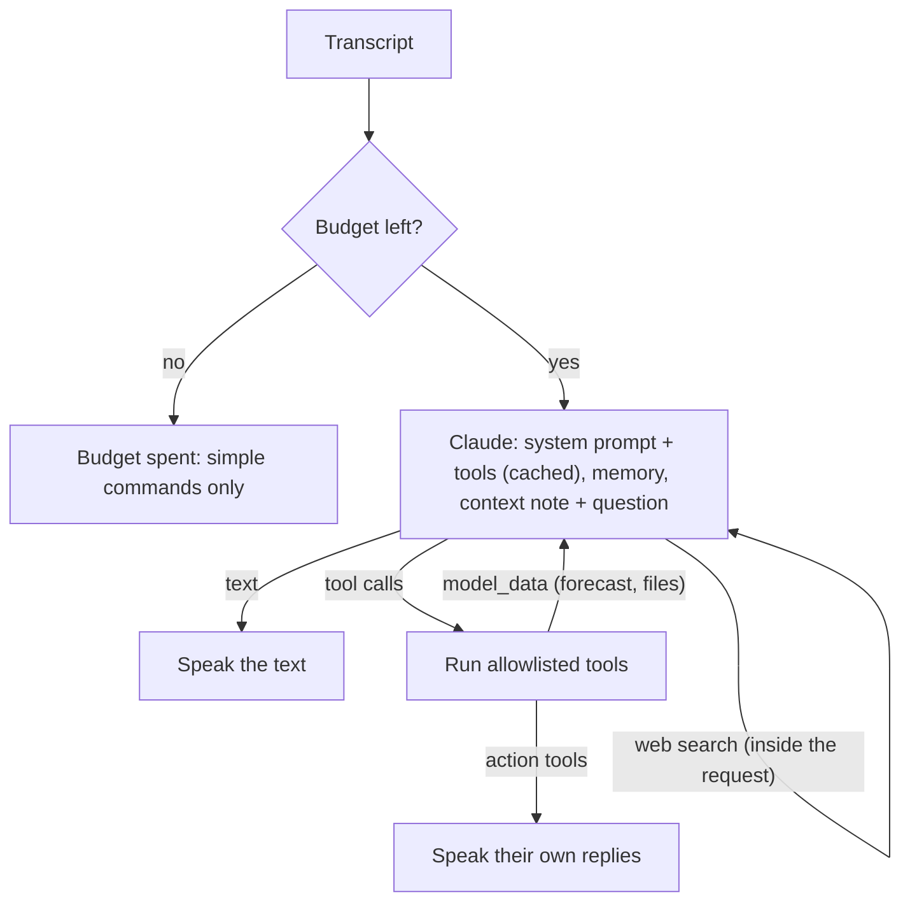
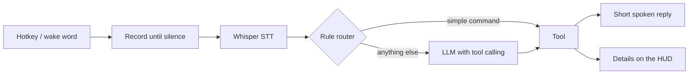
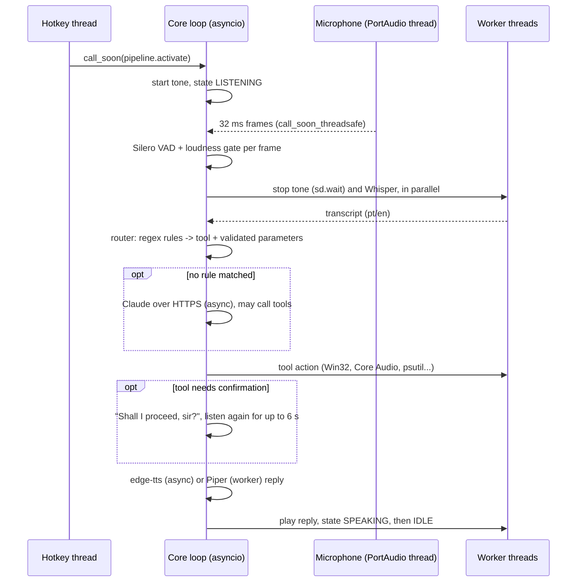
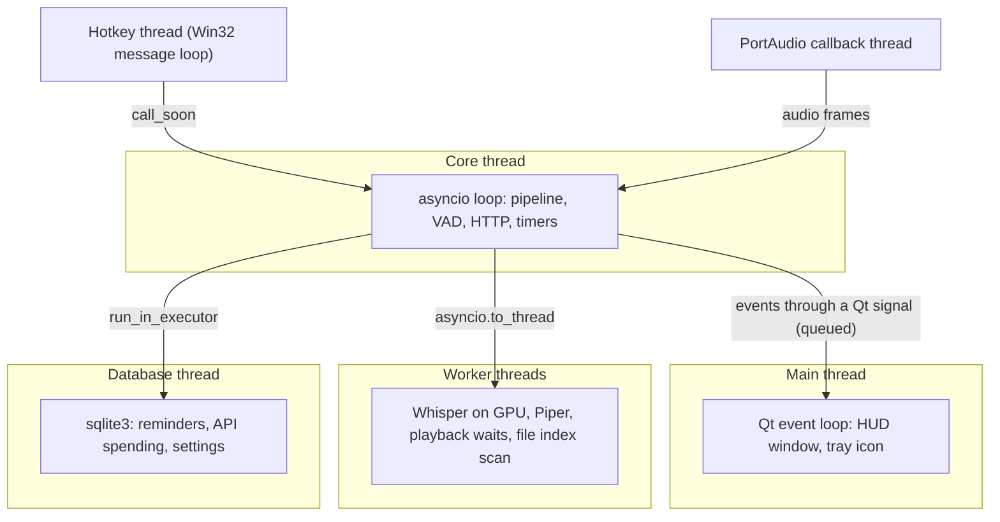

# Architecture

Target architecture of JARVIS v1, built phase by phase. Packages that are still empty
only carry a docstring describing their future responsibility.

## Components

| Package | Responsibility | Since |
|---|---|---|
| `jarvis.app` | Composition root: builds the components and wires them together | Phase 0 |
| `jarvis.config` | Layered TOML configuration and secrets | Phase 0 |
| `jarvis.core` | Core event loop thread, conversation pipeline, states, events for observers, speaker-verification hook | Phase 1 |
| `jarvis.activation` | Global hotkey (Win32 `RegisterHotKey`); wake word in Phase 6 | Phase 1 |
| `jarvis.audio` | Microphone capture, Silero VAD + loudness gate, feedback tones, playback | Phase 1 |
| `jarvis.stt` | faster-whisper on CUDA, language restricted to pt/en | Phase 1 |
| `jarvis.tts` | edge-tts with phrase cache, Piper as offline fallback | Phase 1 |
| `jarvis.i18n` | pt-BR and en texts loaded from locale files | Phase 1 |
| `jarvis.text` | Normalisation, spoken numbers and times, yes/no answers, fuzzy name matching | Phase 2 |
| `jarvis.router` | Bilingual rule router (regex per language); unresolved requests go to the LLM | Phase 2 |
| `jarvis.tools` | Explicit tool list (the allowlist) and one module per tool | Phase 2 |
| `jarvis.windows` | Windows integration: Start menu, media keys, Core Audio, metrics, windows, session | Phase 2 |
| `jarvis.brain` | Claude provider, tool-use loop, web search, persona, short memory, budget guard, news bulletin | Phase 3 |
| `jarvis.storage` | SQLite persistence (reminders, API spending, settings) | Phase 3 |
| `jarvis.hud` | PySide6 heads-up display and tray icon | Phase 5 |

Each pluggable component is a `typing.Protocol` (`Listener`, `SpeechToText`,
`TextToSpeech`, `Player`, `SpeakerVerifier`, `Volume`, `LLMProvider`), so tests replace them with simple
fakes and later phases can swap implementations without touching the pipeline.

## Tools

Every tool subclasses `Tool[P]`, where `P` is a pydantic model of its parameters:

| Member | Purpose |
|---|---|
| `name`, `description` | Identify the tool; the description is written for the LLM |
| `params_model` | Validates arguments from the router or the LLM; its JSON schema feeds tool calling |
| `intents` | Regular expressions per language (`phrasings(pt=..., en=...)`), with named groups |
| `accepts()` | Optional extra check after a regex match (e.g. "is this a known site?") |
| `run()` | Performs the action and returns a `ToolResult` (an i18n reply key and parameters) |

A result may also carry `model_data`: facts for the LLM (a forecast, a list of files) when
the LLM called the tool and still has to compose the answer.

A result may carry `on_confirm`: the pipeline then asks "Shall I proceed, sir?", listens
again without the hotkey and runs the action only on a clear spoken yes (ADR-025). The tool
list in `jarvis/tools/__init__.py` is the allowlist: nothing else can run (ADR-020).

| Tool | Says |
|---|---|
| `open_app`, `open_site`, `close_app` | "Abre o Spotify", "Abre o YouTube", "Fecha o Discord" |
| `system_status`, `media`, `volume`, `lock_pc`, `power` | PC status, playback, volume, lock, shutdown/restart |
| `set_language` | "Fala em inglês", "Idioma automático" (locks the reply language, ADR-033) |
| `create_reminder`, `list_reminders`, `cancel_reminder` | "Me lembra em 20 minutos de tirar a pizza" |
| `weather` | "Vai chover amanhã?", "Como está o tempo em Londres?" (Open-Meteo, ADR-032) |
| `search_files`, `open_search_result` | "Procura o arquivo currículo", "Abre o segundo" (ADR-031) |
| `news` | "Quais as notícias de hoje?", "Notícias sobre IA" (RSS and Google News, ADR-035) |
| `morning_briefing` | "Bom dia, Jarvis": greeting, weather, today's reminders, three stories (ADR-036) |

Web search is not a tool of ours: it runs inside the Claude request (ADR-034), so "Pesquisa
quem ganhou o jogo" or "Search the web for…" reach the brain. The file search declines
requests that mention the internet ("procura na internet…").

## Brain

Requests no rule understands go to Claude Haiku 5.5 with the same tools (ADR-026):

- **Prompt caching:** the persona and the tool schemas never change during a run, so they
  are cached; the date, time and reply language travel in the user message instead.
- **Memory:** the last 6 exchanges, forgotten after 10 minutes of silence, kept as plain
  text (ADR-028).
- **Budget:** every request's tokens and estimated cost go to SQLite; JARVIS warns at
  US$ 4.00 and stops calling the API at US$ 4.90, below the US$ 5 credit (ADR-010).
- **Web search (ADR-034):** Claude's own search tool is offered while today's limit lasts
  (20 searches, at most 2 per question, US$ 0.01 each); the answer must come from the results
  or say nothing was found. Text blocks that merely paste the cited page are not spoken, and
  the sources are logged for the HUD.
- **News (ADR-035):** `NewsService` reads the feeds in parallel (cached 15 minutes), keeps the
  last 24 hours, merges near-identical titles and asks `NewsDigest` (a separate small request)
  for the bulletin; without the LLM the most widely carried headlines are read.
- **Safety:** tool output, search results and headlines are data, never instructions;
  unknown tools and invalid arguments are refused; shutdown, restart and closing programs
  still need a spoken yes.
- **Storage:** `jarvis.storage.Database` runs `sqlite3` on its own single thread; schema
  changes are numbered migrations (`PRAGMA user_version`, ADR-029).

## Request flow

## One conversation turn

## Threads

See [ADR-004](DECISIONS.md#adr-004-concurrency-asyncio-core-worker-threads-qt-on-the-main-thread).

## HUD

The core never calls the HUD: the pipeline, the budget guard and a load sampler publish
plain events (`jarvis.core.events`) on the core thread, and `Hud.post` emits them through a
Qt signal, which Qt queues to the main thread (ADR-004, ADR-037).

| Event | Shown as |
|---|---|
| `StateChanged` | Reactor colour and pace, state label (standing by, listening, thinking, speaking) |
| `UserSpoke`, `JarvisSpoke` | What was heard and the reply; the labels follow the reply language |
| `Shown` | Clickable links (files, news, search sources) or the details text; folds away after 60 s |
| `SpendingChanged` | "API spend: US$ 0.08 of 4.90" |
| `LoadSampled` | CPU, GPU, VRAM and RAM gauges, sampled every 2 s on a worker thread |

The window is frameless, translucent and always on top, and it never takes the focus
(`WindowDoesNotAcceptFocus`, `WA_ShowWithoutActivating`). The reactor is painted with
QPainter at 30 fps only while active (ADR-038); measured: 0% CPU at rest, about 3% while
speaking. Link titles come from the web, so they are always HTML-escaped; only http(s) links
open, and files open through the same safe path as by voice.
