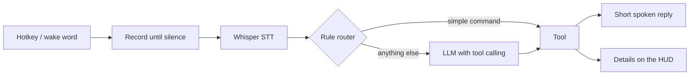
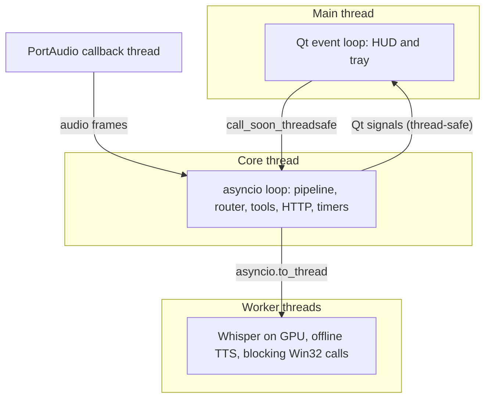

# Architecture

Target architecture of JARVIS v1. It is built phase by phase; packages that are still
empty only carry a docstring describing their future responsibility.

## Components

| Package | Responsibility |
|---|---|
| `jarvis.app` | Composition root: builds the components and wires them together |
| `jarvis.core` | Pipeline orchestration, states, event bus, extension points (speaker verification) |
| `jarvis.activation` | Push-to-talk hotkey and wake word, behind one interface |
| `jarvis.audio` | Microphone capture, voice activity detection, feedback sounds, playback |
| `jarvis.stt` | Speech-to-text (faster-whisper on the GPU) |
| `jarvis.tts` | Text-to-speech: online engine with offline fallback |
| `jarvis.router` | Bilingual rule-based router; unresolved requests go to the LLM |
| `jarvis.brain` | LLM providers, persona, short conversation memory |
| `jarvis.tools` | Tool registry (allowlist) and one module per tool |
| `jarvis.storage` | SQLite persistence (reminders) |
| `jarvis.hud` | PySide6 heads-up display and tray icon |
| `jarvis.config` | Layered TOML configuration and secrets |
| `jarvis.i18n` | pt-BR and en texts loaded from locale files |

## Request flow

## Threads

See [ADR-004](DECISIONS.md#adr-004-concurrency-asyncio-core-worker-threads-qt-on-the-main-thread).

